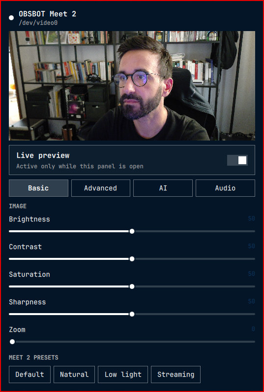
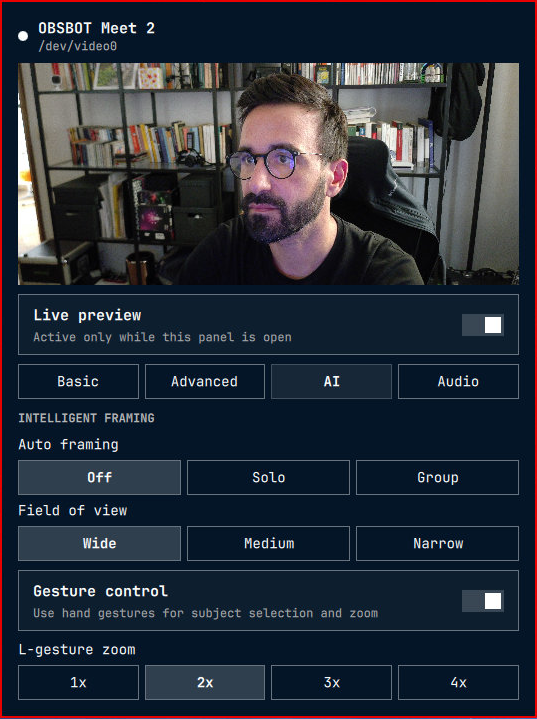
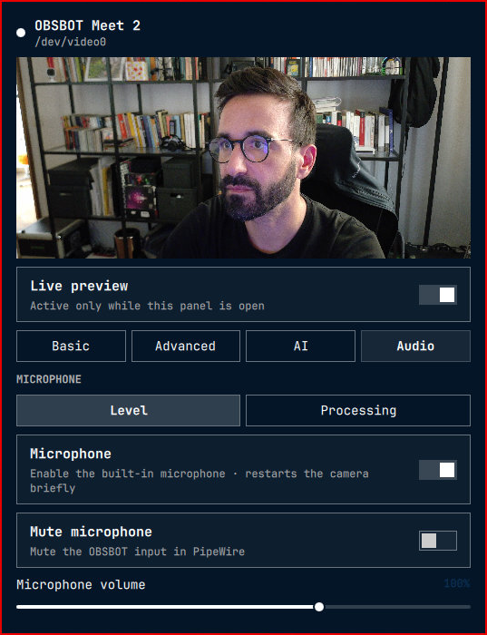
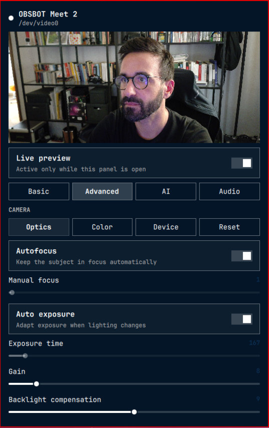
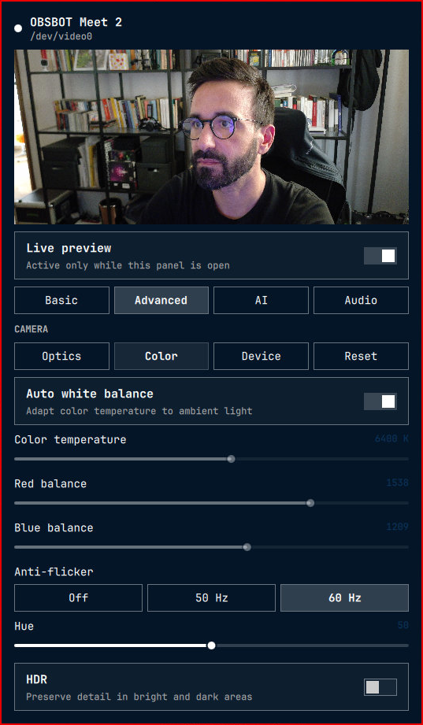
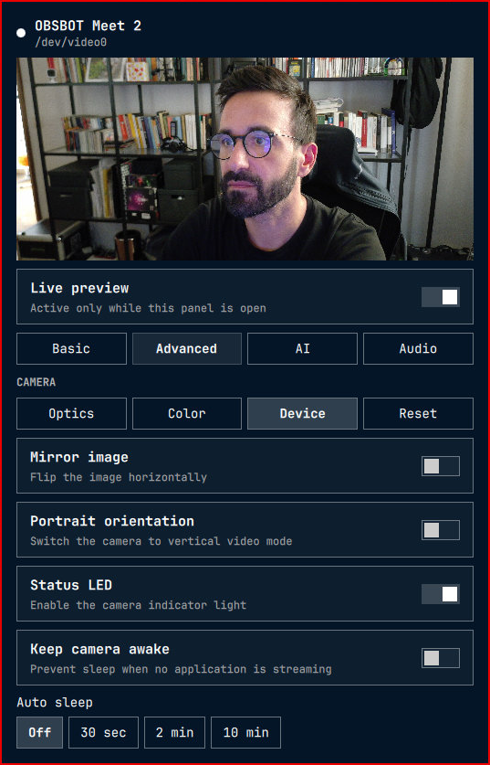

# OBSBOT Center for Omarchy

Control an OBSBOT Meet 2 from the Omarchy bar. Preview the camera, tune its image, manage intelligent framing and gestures, and control its microphone without running OBSBOT Center in the background.

The panel follows the active Omarchy theme and opens the video stream only while its live preview is visible. Camera settings continue to work when the preview is disabled.

> [!NOTE]
> This project is independent from OBSBOT. It is not affiliated with, sponsored by, or endorsed by OBSBOT or Omarchy.

## Interface

| Basic                                                                   | Intelligent framing                                                           | Microphone                                                                |
| ----------------------------------------------------------------------- | ----------------------------------------------------------------------------- | ------------------------------------------------------------------------- |
|  |  |  |

| Optics                                                                                 | Color                                                                                      | Device                                                                                    |
| -------------------------------------------------------------------------------------- | ------------------------------------------------------------------------------------------ | ----------------------------------------------------------------------------------------- |
|  |  |  |

## Features

| Area                    | Controls                                                                                                     |
| ----------------------- | ------------------------------------------------------------------------------------------------------------ |
| **Live preview**        | Starts after the panel opens and releases the video device when the panel closes                             |
| **Image**               | Brightness, contrast, saturation, sharpness, hue, gain, backlight compensation, and zoom                     |
| **Optics**              | Automatic and manual focus, automatic and manual exposure                                                    |
| **Color**               | Automatic and manual white balance, RGB balance, anti-flicker, and HDR                                       |
| **Intelligent framing** | Off, Solo, and Group framing with Wide, Medium, and Narrow fields of view                                    |
| **Gestures**            | Subject selection and L-gesture zoom with factors from 1x to 4x                                              |
| **Microphone**          | Power, PipeWire mute and volume, automatic gain, capture distance, audio during sleep, and four pickup modes |
| **Device**              | Mirror, portrait orientation, status LED, keep-awake, and automatic sleep                                    |
| **Profiles**            | Default, Natural, Low light, and Streaming image profiles                                                    |
| **Automation**          | IPC calls for camera controls, framing, gestures, audio, profiles, preview state, and resets                 |

Controls are discovered from the connected camera. Unsupported standard V4L2 controls stay hidden instead of showing values that the device cannot apply.

## Install

```bash
omarchy plugin add https://github.com/stefanomainardi/omarchy-obsbot-center.git --enable
```

The widget appears in the right section of the Omarchy bar. It can also be enabled manually:

```bash
omarchy plugin enable io.github.stefanomainardi.obsbot-center --section right
```

## Requirements

- **Desktop.** Omarchy 4 or newer with the Quattro shell.
- **Camera.** OBSBOT Meet 2, USB ID `3564:fefb`, for the verified vendor controls.
- **Video.** `qt6-multimedia` and `v4l-utils`.
- **Device discovery.** `udev`.
- **Microphone controls.** WirePlumber with `wpctl`.
- **Build tools.** A C compiler exposed as `cc`, required once per helper source revision.

No daemon or system service is installed. The plugin does not require root access or a udev rule on a standard Omarchy installation.

## Use the panel

Click the camera icon in the bar to open the panel. Press `Escape` to close it.

- **Basic.** Everyday image controls and picture profiles.
- **Advanced.** Optics, color, and persistent device settings. Each page has a contextual reset.
- **AI.** Auto framing, field of view, gesture control, and gesture zoom factor.
- **Audio.** Meet 2 microphone level, mute, processing, distance, and pickup mode.

When auto framing is active, the firmware owns zoom and the manual slider is disabled. An open palm toggles auto framing. An L-shaped hand gesture toggles gesture zoom.

### Live preview and privacy

The preview is created only after the panel opens. Closing the panel destroys the camera object and releases `/dev/video0` for meeting and recording applications.

The bar uses USB metadata for background device detection. It does not poll the capture stream, so the camera LED remains a useful indicator of real video use.

Turn the preview off when another application needs exclusive access:

```bash
omarchy bar set io.github.stefanomainardi.obsbot-center preview false --json
```

The setting persists across shell restarts. All non-preview controls remain available.

## Settings

| Key                  | Default | Purpose                                             |
| -------------------- | ------- | --------------------------------------------------- |
| `refreshIntervalSec` | `5`     | Synchronization interval while the panel is open    |
| `hideWhenAbsent`     | `false` | Hide the bar icon when no OBSBOT camera is detected |
| `preview`            | `true`  | Enable the live preview while the panel is open     |

```bash
omarchy bar set io.github.stefanomainardi.obsbot-center refreshIntervalSec 10 --json
omarchy bar set io.github.stefanomainardi.obsbot-center hideWhenAbsent true --json
```

## Command-line control

The panel delegates hardware access to `bin/obsbot-control`. The helper validates every writable control and rejects unknown values.

```bash
./bin/obsbot-control detect
./bin/obsbot-control status
./bin/obsbot-control set brightness 50
./bin/obsbot-control reset optics
./bin/obsbot-control preset natural
./bin/obsbot-control camera auto-framing solo
./bin/obsbot-control camera fov wide
./bin/obsbot-control camera gesture-control on
./bin/obsbot-control camera gesture-zoom 2x
./bin/obsbot-control camera audio-mode omni
./bin/obsbot-control audio volume 100
./bin/obsbot-control audio mute toggle
```

## IPC and keybindings

```bash
omarchy-shell io.github.stefanomainardi.obsbot-center framing solo
omarchy-shell io.github.stefanomainardi.obsbot-center fov wide
omarchy-shell io.github.stefanomainardi.obsbot-center gestureZoom 2x
omarchy-shell io.github.stefanomainardi.obsbot-center audioMode omni
omarchy-shell io.github.stefanomainardi.obsbot-center microphoneVolume 100
omarchy-shell io.github.stefanomainardi.obsbot-center microphoneMute toggle
omarchy-shell io.github.stefanomainardi.obsbot-center reset color
omarchy-shell io.github.stefanomainardi.obsbot-center preset natural
```

Available calls:

```text
open close show hide toggle refresh
previewOn previewOff
framing fov gesture gestureZoom
audioMode microphoneVolume microphoneMute
camera control reset preset
```

Hardware writes still pass through the helper's allowlists.

## Hardware compatibility

OBSBOT Meet 2 is the tested device. The plugin identifies OBSBOT cameras through vendor ID `3564` or their USB product name.

Standard preview and V4L2 controls can adapt to other OBSBOT models. Proprietary controls remain hidden unless the connected model and protocol are verified.

### Verified Meet 2 controls

- **Framing.** Solo and Group auto framing, field of view, and live state readback.
- **Gestures.** Gesture enablement and zoom factors from 1x to 4x.
- **Orientation.** Mirror and portrait output.
- **Power.** Status LED, keep-awake, automatic sleep, and microphone during sleep.
- **Audio.** Microphone power, automatic gain, capture distance, Pure Audio, Smart Omni, Directional, and Front/Rear modes.

Changing microphone power makes the Meet 2 re-enumerate over USB. The operation can take approximately 15 to 30 seconds. The plugin waits for the device before rebuilding the preview.

## Privacy and security

The plugin runs inside the Omarchy shell with the current user's permissions. It does not use the network, upload frames, record video, or retain preview images.

`QtMultimedia` accesses the video device only for the optional live preview. The helper invokes `udevadm`, `v4l2-ctl`, and `wpctl` locally. It restricts V4L2 and Meet 2 writes to known controls and validated values.

Every local tool call runs under a wall-clock timeout with a capped output size, and the USB helper bounds its own device session with an alarm, so a camera that stops answering cannot hang the bar. Set `OBSBOT_TOOL_TIMEOUT` (seconds, default `5`) to adjust the bound.

The cache and state directories are created with mode `0700` and refused when they are symlinks or owned by another user. The cached helper is executed only when it is a private regular file whose SHA-256 matches the record written at build time; anything else at that path is discarded and rebuilt from source.

Review third-party Omarchy plugins before installing them. Omarchy plugins run unsandboxed inside a long-running shell process.

## Known limitations

- **Firmware updates.** The plugin does not download or install camera firmware.
- **Software effects.** Virtual camera output, background replacement, blur, beauty filters, and recording are not included.
- **Exclusive capture.** Another application can prevent the live preview from opening when it holds the camera exclusively.
- **Model coverage.** Proprietary features are enabled only for the verified Meet 2 USB product ID.
- **Initial setup.** The first use of a Meet 2 vendor control compiles the local helper and may take a moment.

## Remove

```bash
omarchy plugin remove io.github.stefanomainardi.obsbot-center
```

Optional state is stored in `~/.local/state/obsbot-center-omarchy/`. Remove that directory manually to delete remembered Meet 2 settings.

## Development

```bash
omarchy plugin validate .
qmllint -I /usr/share/omarchy/shell BarWidget.qml Panel.qml ControlSlider.qml
./tests/test_static.sh
```

The suite checks:

- **Manifest and scripts.** Plugin validation and shell syntax.
- **Protocol encoding.** Every known Meet 2 command frame and rejected value.
- **Audio controls.** PipeWire source selection, volume, mute, and invalid input.
- **Native helper.** Warning-free hardened C compilation into a temporary test directory.
- **Local build cache.** Source-hash naming, private permissions, hash record, and cache reuse.
- **Hardening.** Symlinked or loose cache and state paths, planted or tampered helpers, tool timeouts, and output caps.
- **Theming.** Rejection of fixed hexadecimal UI colors in QML.

No automated test changes physical camera state. Hardware verification remains a separate manual step.

## Project structure

```text
BarWidget.qml          Bar icon, settings, and IPC
Panel.qml              Theme-aware control panel and preview lifecycle
ControlSlider.qml      Shared camera slider
bin/obsbot-control     Device discovery and safe command-line backend
tools/xu-probe.c       Meet 2 USB extension-unit protocol helper source
tests/                 Protocol, audio, hardening, and static regression tests
manifest.json          Omarchy plugin metadata and settings schema
```

## Reverse engineering

Meet 2 vendor controls were derived for Linux interoperability by inspecting the official desktop application's behavior and validating individual USB extension-unit frames against hardware. The project does not include vendor code, firmware, or proprietary assets.

Protocol support is intentionally conservative. Unknown models and values are rejected instead of being guessed.

The plugin never ships or downloads a prebuilt helper. On first use, it compiles `tools/xu-probe.c` into `~/.cache/obsbot-center-omarchy/`. The cache filename includes the source SHA-256, so a source update produces a new executable without trusting an older artifact. A separate record stores the SHA-256 of the compiled helper, and the helper is rebuilt whenever the two no longer match.

## Contributing

Issues and pull requests are welcome. Include the camera model, USB ID, firmware version, relevant command output, and whether the behavior was reproduced with the official application.

Run `./tests/test_static.sh` before opening a pull request. Keep interface colors, fonts, borders, and spacing connected to Omarchy theme tokens.

## License

Released under the MIT License. See [LICENSE](LICENSE).
